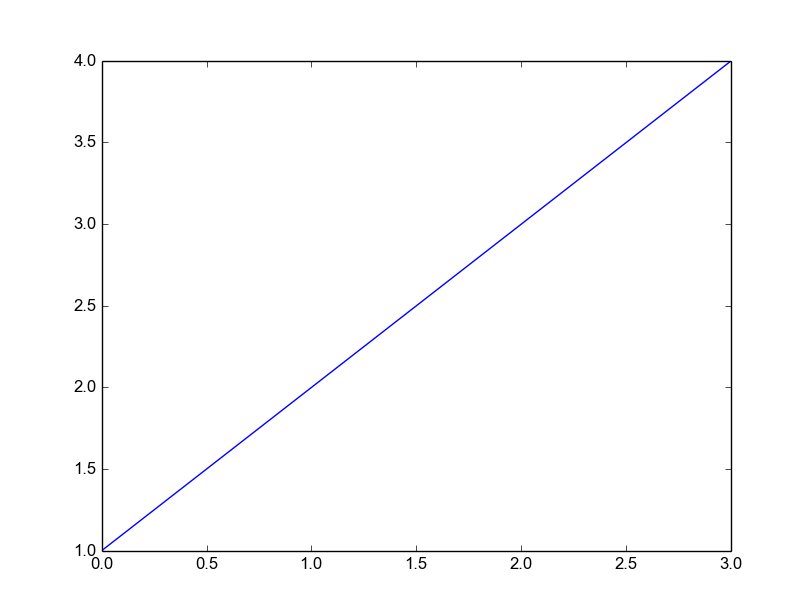
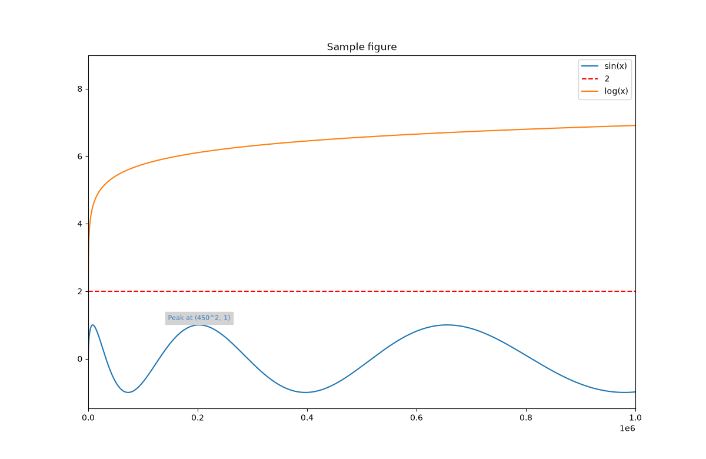
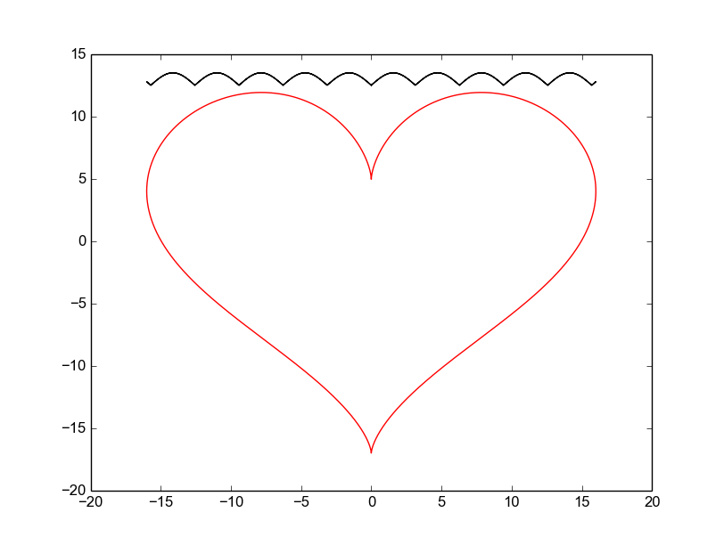
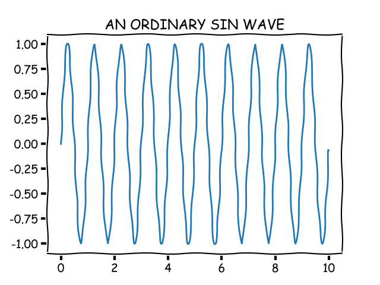
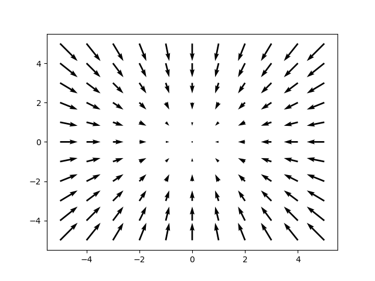
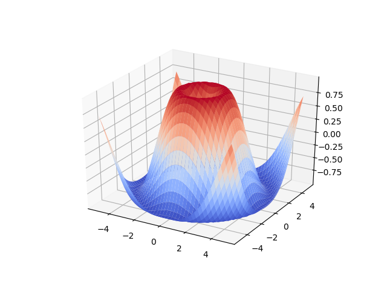

matplotlib-cpp
==============

Welcome to matplotlib-cpp, possibly the simplest C++ plotting library.
It is built to resemble the plotting API used by Matlab and matplotlib.


Usage
-----
Complete minimal example:
```cpp
#include "matplotlibcpp.h"
namespace plt = matplotlibcpp;
int main() {
    plt::plot({1,3,2,4});
    plt::show();
}
```
    g++ minimal.cpp -std=c++11 $(python3-config --includes) $(python3 -c 'import numpy; print("-I"+numpy.get_include())') $(python3-config --ldflags --embed)

**Result:**



A more comprehensive example:
```cpp
#include "matplotlibcpp.h"
#include <cmath>

namespace plt = matplotlibcpp;

int main()
{
    // Prepare data.
    int n = 5000;
    std::vector<double> x(n), y(n), z(n), w(n,2);
    for(int i=0; i<n; ++i) {
        x.at(i) = i*i;
        y.at(i) = sin(2*M_PI*i/360.0);
        z.at(i) = log(i);
    }

    // Set the size of output image to 1200x780 pixels
    plt::figure_size(1200, 780);
    // Plot line from given x and y data. Color is selected automatically.
    plt::plot(x, y);
    // Plot a red dashed line from given x and y data.
    plt::plot(x, w,"r--");
    // Plot a line whose name will show up as "log(x)" in the legend.
    plt::named_plot("log(x)", x, z);
    // Set x-axis to interval [0,1000000]
    plt::xlim(0, 1000*1000);
    // Add graph title
    plt::title("Sample figure");
    // Enable legend.
    plt::legend();
    // Save the image (file format is determined by the extension)
    plt::save("./basic.png");
}
```
    g++ basic.cpp -std=c++11 $(python3-config --includes) $(python3 -c 'import numpy; print("-I"+numpy.get_include())') $(python3-config --ldflags --embed)

**Result:**



String x-axis labels with legend:
```cpp
#include "../matplotlibcpp.h"
#include <string>
#include <vector>

namespace plt = matplotlibcpp;

int main()
{
    std::vector<std::string> x = {"Jan 2021", "Feb 2021", "Mar 2021"};
    std::vector<double> y = {58.4, 61.2, 63.9};

    plt::named_plot("Vehicle speed (max)", x, y, "o-");
    plt::legend();
    plt::save("./string_xaxis_named_plot.png");
}
```
    g++ examples/string_xaxis_named_plot.cpp -std=c++11 -I. $(python3-config --includes) $(python3 -c 'import numpy; print("-I"+numpy.get_include())') $(python3-config --ldflags --embed)

Expected behavior and constraints:
- `x` is a `std::vector<std::string>` and `y` is numeric with matching length.
- String labels are mapped as categorical x values by matplotlib.
- Use `plt::save(...)` for headless runs or `plt::show()` for interactive runs.

Alternatively, matplotlib-cpp also supports some C++11-powered syntactic sugar:
```cpp
#include <cmath>
#include "matplotlibcpp.h"

using namespace std;
namespace plt = matplotlibcpp;

int main()
{
    // Prepare data.
    int n = 5000; // number of data points
    vector<double> x(n),y(n);
    for(int i=0; i<n; ++i) {
        double t = 2*M_PI*i/n;
        x.at(i) = 16*sin(t)*sin(t)*sin(t);
        y.at(i) = 13*cos(t) - 5*cos(2*t) - 2*cos(3*t) - cos(4*t);
    }

    // plot() takes an arbitrary number of (x,y,format)-triples.
    // x must be iterable (that is, anything providing begin(x) and end(x)),
    // y must either be callable (providing operator() const) or iterable.
    plt::plot(x, y, "r-", x, [](double d) { return 12.5+abs(sin(d)); }, "k-");


    // show plots
    plt::show();
}
```
    g++ modern.cpp -std=c++11 $(python3-config --includes) $(python3 -c 'import numpy; print("-I"+numpy.get_include())') $(python3-config --ldflags --embed)

**Result:**



Or some *funny-looking xkcd-styled* example:
```cpp
#include "matplotlibcpp.h"
#include <vector>
#include <cmath>

namespace plt = matplotlibcpp;

int main() {
    std::vector<double> t(1000);
    std::vector<double> x(t.size());

    for(size_t i = 0; i < t.size(); i++) {
        t[i] = i / 100.0;
        x[i] = sin(2.0 * M_PI * 1.0 * t[i]);
    }

    plt::xkcd();
    plt::plot(t, x);
    plt::title("AN ORDINARY SIN WAVE");
    plt::save("xkcd.png");
}

```
    g++ xkcd.cpp -std=c++11 $(python3-config --includes) $(python3 -c 'import numpy; print("-I"+numpy.get_include())') $(python3-config --ldflags --embed)

**Result:**



When working with vector fields, you might be interested in quiver plots:
```cpp
#include "../matplotlibcpp.h"

namespace plt = matplotlibcpp;

int main()
{
    // u and v are respectively the x and y components of the arrows we're plotting
    std::vector<int> x, y, u, v;
    for (int i = -5; i <= 5; i++) {
        for (int j = -5; j <= 5; j++) {
            x.push_back(i);
            u.push_back(-i);
            y.push_back(j);
            v.push_back(-j);
        }
    }

    plt::quiver(x, y, u, v);
    plt::show();
}
```
    g++ quiver.cpp -std=c++11 $(python3-config --includes) $(python3 -c 'import numpy; print("-I"+numpy.get_include())') $(python3-config --ldflags --embed)

**Result:**



When working with 3d functions, you might be interested in 3d plots:
```cpp
#include "../matplotlibcpp.h"

namespace plt = matplotlibcpp;

int main()
{
    std::vector<std::vector<double>> x, y, z;
    for (double i = -5; i <= 5;  i += 0.25) {
        std::vector<double> x_row, y_row, z_row;
        for (double j = -5; j <= 5; j += 0.25) {
            x_row.push_back(i);
            y_row.push_back(j);
            z_row.push_back(::std::sin(::std::hypot(i, j)));
        }
        x.push_back(x_row);
        y.push_back(y_row);
        z.push_back(z_row);
    }

    plt::plot_surface(x, y, z);
    plt::show();
}
```

**Result:**



Installation
------------

matplotlib-cpp works by wrapping the popular python plotting library matplotlib. (matplotlib.org)
This means you have to have a working python installation, including development headers.
On Ubuntu:

    sudo apt-get install python3-matplotlib python3-numpy python3-dev

If, for some reason, you're unable to get a working installation of numpy on your system,
you can define the macro `WITHOUT_NUMPY` before including the header file to erase this
dependency.

The C++-part of the library consists of the single header file `matplotlibcpp.h` which
can be placed anywhere.

Since a python interpreter is opened internally, it is necessary to link
against `libpython` in order to user matplotlib-cpp. Most versions should
work, although python likes to randomly break compatibility from time to time
so some caution is advised when using the bleeding edge.


# CMake

The C++ code is compatible to both python2 and python3. The `CMakeLists.txt` file uses python3 by default; pass `-DUSING_PYTHON3=OFF` to cmake to build against python2 instead.
Pass `-DMATPLOTLIB_CPP_BUILD_EXAMPLES=OFF` or `-DMATPLOTLIB_CPP_BUILD_EXAMPLES=ON` to control whether the examples are built; they are off by default when matplotlib-cpp is used as a subproject.

**NOTE**: By design (of python), only a single python interpreter can be created per
process. When using this library, *no other* library that is spawning a python
interpreter internally can be used.

To compile the code without using cmake, the compiler invocation should look like
this:

    g++ example.cpp -std=c++11 $(python3-config --includes) $(python3 -c 'import numpy; print("-I"+numpy.get_include())') $(python3-config --ldflags --embed)

`python3-config` prints the include and linker flags of your Python installation.
`--embed` is needed for Python 3.8 and newer; leave it out for older versions.

This can also be used for linking against a custom build of python

    g++ example.cpp -I/usr/local/include/fancy-python4 -L/usr/local/lib -lfancy-python4

# Vcpkg

You can download and install matplotlib-cpp using the [vcpkg](https://github.com/Microsoft/vcpkg) dependency manager:

    git clone https://github.com/Microsoft/vcpkg.git
    cd vcpkg
    ./bootstrap-vcpkg.sh
    ./vcpkg integrate install
    ./vcpkg install matplotlib-cpp
  
The matplotlib-cpp port in vcpkg is kept up to date by Microsoft team members and community contributors. If the version is out of date, please [create an issue or pull request](https://github.com/Microsoft/vcpkg) on the vcpkg repository.


# Setup notes

matplotlib-cpp embeds a Python interpreter. The Python you compile and link
against must be the one that has matplotlib and numpy installed, and the program
must find that same Python again at runtime.

**Windows / Visual Studio**

* The simplest setup is CMake: link your target against
  `matplotlib_cpp::matplotlib_cpp` (via `add_subdirectory` or `FetchContent`), or
  install matplotlib-cpp with vcpkg as shown above.
* Build for the same architecture as your Python: a 64-bit Python needs an x64
  build. Use the Release configuration unless you have Python's debug libraries
  (`pythonXY_d.lib`).
* The Python DLL (e.g. `python311.dll`) must be on `PATH` or next to the executable.
* With Anaconda or conda, set `PYTHONHOME` to the environment root (e.g.
  `C:\Miniconda3\envs\myenv`) if the program fails with
  `No module named 'encodings'` or cannot find matplotlib.
* If Qt reports that it could not load the platform plugin, copy the `platforms`
  folder from `<Anaconda>\Library\plugins` next to the executable, or select a
  non-Qt backend with `plt::backend("TkAgg")` before the first plot command.

**macOS**

* Link against `Python3::Python`, which the `matplotlib_cpp` CMake target does.
  `Python3::Module` alone leaves the Python symbols unresolved and fails with
  errors like `symbol not found in flat namespace`.
* A conda or framework Python is loaded through `@rpath`, so add the directory
  containing `libpython3.X.dylib` as an rpath, e.g.
  `-Wl,-rpath,/path/to/env/lib`.


# C++11

Currently, c++11 is required to build matplotlib-cpp. The last working commit that did
not have this requirement was `717e98e752260245407c5329846f5d62605eff08`.

Note that support for c++98 was dropped more or less accidentally, so if you have to work
with an ancient compiler and still want to enjoy the latest additional features, I'd
probably merge a PR that restores support.


Governance
----------
This project is currently using automated open-source governance. Pull requests
are reviewed by an AI model against acceptance criteria written by the
maintainer. Each pull request receives one of four verdicts:

* **Merge**: the pull request is merged as-is.
* **Merge with fix-ups**: the change is wanted but needs small adjustments. An AI
  agent applies them, pushes the result, and merges.
* **Reject without prejudice**: the pull request is closed in its current form, for
  example because it is broken, outdated, or mixes unrelated changes. You are
  welcome to reopen or resubmit it.
* **Reject with prejudice**: the change is out of scope for the project and should
  not be resubmitted.

Every verdict comes with a comment explaining the decision. The acceptance criteria
themselves are not published.

The maintainer remains responsible for the project and can override any decision.

### Using a version without AI-reviewed code

If you prefer not to use code that was accepted through this process, use commit
[`ef0383f`](https://github.com/lava/matplotlib-cpp/commit/ef0383f1315d32e0156335e10b82e90b334f6d9f)
(2021-04-13). It is the last commit made before AI review was introduced. Every
change before it was reviewed and merged by a human.

    git clone https://github.com/lava/matplotlib-cpp.git
    cd matplotlib-cpp
    git checkout ef0383f1315d32e0156335e10b82e90b334f6d9f

With CMake's `FetchContent`, set `GIT_TAG ef0383f1315d32e0156335e10b82e90b334f6d9f`.


Why?
----
I initially started this library during my diploma thesis. The usual approach of
writing data from the c++ algorithm to a file and afterwards parsing and plotting
it in python using matplotlib proved insufficient: Keeping the algorithm
and plotting code in sync requires a lot of effort when the C++ code frequently and substantially
changes. Additionally, the python yaml parser was not able to cope with files that
exceed a few hundred megabytes in size.

Therefore, I was looking for a C++ plotting library that was extremely easy to use
and to add into an existing codebase, preferably header-only. When I found
none, I decided to write one myself, which is basically a C++ wrapper around
matplotlib. As you can see from the above examples, plotting data and saving it
to an image file can be done as few as two lines of code.

The general approach of providing a simple C++ API for utilizing python code
was later generalized and extracted into a separate, more powerful
library in another project of mine, [wrappy](http://www.github.com/lava/wrappy).


Todo/Issues/Wishlist
--------------------
* This library is not thread safe. Protect all concurrent access with a mutex.
  Sadly, this is not easy to fix since it is not caused by the library itself but
  by the python interpreter, which is itself not thread-safe.

* It would be nice to have a more object-oriented design with a Plot class which would allow
  multiple independent plots per program.

* Right now, only a small subset of matplotlibs functionality is exposed. Stuff like xlabel()/ylabel() etc. should
  be easy to add.

* If you use Anaconda on Windows, you might need to set PYTHONHOME to Anaconda home directory and QT_QPA_PLATFORM_PLUGIN_PATH to %PYTHONHOME%Library/plugins/platforms. The latter is for especially when you get the error which says 'This application failed to start because it could not find or load the Qt platform plugin "windows"
in "".'

* MacOS: `Unable to import matplotlib.pyplot`. Cause: In mac os image rendering back end of matplotlib (what-is-a-backend to render using the API of Cocoa by default). There is Qt4Agg and GTKAgg and as a back-end is not the default. Set the back end of macosx that is differ compare with other windows or linux os.
Solution is described [here](https://stackoverflow.com/questions/21784641/installation-issue-with-matplotlib-python?noredirect=1&lq=1), additional information can be found there too(see links in answers).
